<!-- Perfil de André Dantas · cartões em assets/ gerados pela skill perfil-github -->

 

  

**Construo SaaS do 0 a 1 com IA e mostro o processo inteiro: especificação antes de automação, agente em loop, você aprova a entrega.**

Programador desde 2009, na loja do meu pai. Hoje CTO de software house, em home office.

 

<picture>
  <source media="(max-width: 700px)" srcset="assets/papeis-celular.svg" />
  
</picture>

 

<picture>
  <source media="(max-width: 700px)" srcset="assets/numeros-celular.svg" />
  
</picture>

 

## 💼 Cases

Cliente que não autorizou o nome aparece pelo setor.

 

<picture>
  <source media="(max-width: 700px)" srcset="assets/cases-celular.svg" />
  
</picture>

<b>📖 Problema, solução e resultado de cada case</b>

 

**⚖️ [ChatADV](https://chatadv.com.br)** · CTO
- **Problema:** advogado perde horas montando peça e pesquisando jurisprudência, e um LLM genérico inventa precedente.
- **Solução:** plataforma de IA para a advocacia brasileira: peças processuais, pesquisa em base de jurisprudência real, análise de documentos e transcrição, pelo WhatsApp e pela web.
- **Meu papel:** CTO: arquitetura (API em Laravel 12 com FrankenPHP, front em Next.js 16, motor de chat sobre um fork do LibreChat), infraestrutura em Docker Swarm e liderança do time.

**🚚 Cargo Viewer** · Diretor de Tecnologia
- **Problema:** cada frota usa um rastreador diferente (Autotrac, Sascar, Omnilink, Onixsat e outros), e o gestor precisava de um painel para cada um.
- **Solução:** plataforma que agrega oito tecnologias de rastreamento num portal web e num app para motoristas, com microsserviços de integração, pontes em Python para os rastreadores e geocodificação própria com Nominatim.
- **Meu papel:** Diretor de Tecnologia: arquitetura das integrações, infraestrutura e direção do time.

**🏆 SaaS de IA** · pela QWize
- **Problema:** produto de IA com tecnologia boa, mas apontado para o público errado e sem método de lançamento.
- **Solução:** reorientamos produto, público e metodologia de lançamento antes de escalar a construção.
- **Resultado:** R$500 mil de receita no primeiro ano (2025) e 2º lugar no prêmio Sebrae 2025 (R$150 mil).
- **Meu papel:** CTO pela QWize: estratégia de produto e direção técnica.

**📈 Operação digital** · consultoria
- **Problema:** a operação crescia em faturamento, mas a margem ficava pelo caminho: processo implícito, tudo na cabeça do dono.
- **Solução:** primeiro organizar (processo, papéis, rituais), só depois automatizar o que já estava claro.
- **Resultado:** lucro líquido dobrado em 18 meses com apenas 20% a mais de faturamento anual.
- **Meu papel:** consultoria de operação e tecnologia.

**🔁 SaaS de assinatura** · pela QWize
- **Problema:** a tentação de lançar com tudo pronto e descobrir tarde o que o cliente queria.
- **Solução:** MVP com três funcionalidades, lançado cedo, e evolução guiada pelo uso real.
- **Resultado:** MRR acima de R$100 mil com mais de 2.000 assinantes.
- **Meu papel:** CTO: produto e direção técnica.

**🎁 RevelaBebê** · fundador
- **Problema:** provar, num produto meu, que o método aguenta greenfield de verdade.
- **Solução:** presentes virtuais, números da sorte e sorteio ao vivo, construído com o fluxo entrevista → PRD canônico → stories → agente em loop.
- **Meu papel:** construí do zero.

Fontes: ChatADV: chatadv.com.br. Cases de cliente aparecem pelo setor por acordo de confidencialidade; números informados pelas próprias operações (R$500k e prêmio Sebrae: 2025).

 

## 🧠 Como eu trabalho

<picture>
  <source media="(max-width: 700px)" srcset="assets/metodo-celular.svg" />
  
</picture>

**Pare de ser babá de harness.** Especifique uma vez e deixe o agente trabalhar.

**Automatizar caos cria caos mais rápido:**

<picture>
  <source media="(max-width: 700px)" srcset="assets/principios-celular.svg" />
  
</picture>

 

## 📦 Aberto no GitHub

<picture>
  <source media="(max-width: 700px)" srcset="assets/abertos-celular.svg" />
  
</picture>

<a href="https://github.com/andrefrd/aios-squads">aios-squads</a> · <a href="https://github.com/andrefrd/agno-pm-agent">agno-pm-agent</a> · <a href="https://github.com/andrefrd/plaud-linux">plaud-linux</a>

O resto é código de cliente e de produto, em repositórios privados.

 

## 🛠️ Stack

 

 
 

 

## 📫 Vamos conversar

**Quer construir com IA sem virar babá de agente?**

Comunidade e cursos na <a href="https://vibecodingsociety.ai">Vibe Coding Society</a> · projeto sob medida na <a href="https://qwize.io">QWize</a> · mentoria individual em <a href="https://andrefrd.com">andrefrd.com</a>

 

